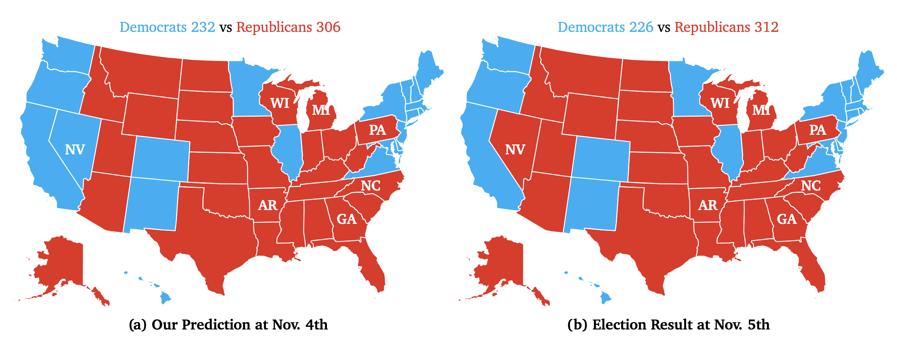

# FlockVote

Open-source reproduction of our [FlockVote method](https://www.arxiv.org/pdf/2512.05982). 
The prediction process requires only less than 160k tokens per state.



In 2024 U.S. presidential election, we predict that Donald Trump would win in six out of seven swing states (Arizona, Georgia, Michigan, Nevada, North Carolina, Pennsylvania, Wisconsin), with Nevada being the exception where Kamala Harris is projected to win narrowly by 0.17%. This high alignment with actual election results demonstrates that our agent-based modeling framework, FlockVote, powered by Qwen-Max, effectively captures the intricate dynamics of voter behavior.

<!-- The detailed results are publicly available [here](https://api.wandb.ai/links/lfzhou/6og5f2xn). -->

## Installation

Prerequisite: Python >= 3.9 and [uv](https://github.com/astral-sh/uv) installed.

```bash
# install uv if needed (Linux/macOS)
curl -LsSf https://astral.sh/uv/install.sh | sh

# create env + install deps (uv manages .venv automatically)
uv sync
# optional: activate env
source .venv/bin/activate
```

> If you already have a global `VIRTUAL_ENV` exported, either unset it or run `uv sync --active` to target that environment.

**Dependency**: If you call LLMs through APIs, cpu is enough. If you want to use local LLMs, you need to deploy them according to their requirements (See [Predict U.S. Election on Your Laptop!](#predict-u.s.-election-on-your-laptop)).

## Quick Start in Seconds

If you want to try the experiment setting of 2024 election prediction in a quick way, specify your LLM API base and key in `./config/llms.yaml` and directly run:

```bash
uv run python main.py
```

If you want to try your custom config files, you can directly run:

```bash
uv run python main.py --flock /path/to/flock.yaml --vote /path/to/vote.yaml --llms /path/to/llms.yaml
```

Your config files can override any of the defaults (`./config/flock.yaml`, `./config/vote.yaml`, `./config/llms.yaml`). Feel free to:

- Try different simulation numbers
- Try different states, including non-swing states
- Try different LLMs, add new APIs in your custom config file
- Try your own prompt, such as different context information or different prompt structure
- ...

> It is not suggested to directly modify the default config files; copy and edit them instead.

### Config structure (new)

- `config/flock.yaml`: population/simulation setup (states, sim_num, random_seed, parallel workers, optional data paths, default model name).
- `config/vote.yaml`: experiment/vote task (year, candidates, prompt structure, context info, wandb flags, temperature/retry settings).
- `config/llms.yaml`: LLM registry (api_base/key, cost_input/output, per-model kwargs). No defaults here; choose the model via `model_name` in flock/vote.

The runtime config is assembled as: flock + vote + llms + CLI/override kwargs.

## Programmatic use

You can import the simulator and call the `vote` entrypoint via the `Flock` class (`fit` is kept as a simple alias):

```python
from flock import Flock

flock = Flock(flock_config="./config/flock.yaml", llm_config="./config/llms.yaml")
prediction_df = flock.vote(vote_config="./config/vote.yaml")
```

## Predict U.S. Election on Your Laptop!

We recommend using [LM Studio](https://lmstudio.ai/) or [Ollama](https://ollama.com/) to deploy LLMs locally.

We have tested that on an **M3 Macbook Pro** without a power cable connected, the accurate election predictions can be produced with Llama3.2-3B-Instruct in only **one hour**.

We take LM Studio here as an example:

1. Install the software and download the model weights, see [LM Studio Installation](https://lmstudio.ai/docs)

2. Start an API service with the downloaded model weights, see [LM Studio API](https://lmstudio.ai/docs/api/server)

3. Add the `api_base` in your custom config file and configure your model name, for example:

```yaml
model_name: llama-3.2-3b-instruct
llama-3.2-3b-instruct:
  api_base: http://localhost:1234/v1
```

4. Having fun predicting the election on your laptop!

## Fast Q&A


### Population Data

The population data is from [US Census Bureau](https://data.census.gov/table/ACSSPP1Y2023.S0201?q=S0201&t=-01&g=010XX00US$0400000).

We have collected the population data in 2024/2020/2016 and saved it in `./data` folder. We have also implemented the processing method for 2024/2020/2016 data.

If you want to use the population data of other years, you can directly add it to the `./data` folder and set the file name as `./data/state_data{year}.csv`. Remember to check the function `build_population` in `./data_loader.py` to make sure it is compatible with the data you add.

> The data of 2024 is not available yet, so we use the data of 2023 instead.

### Context Information

If you want to use your own context information, open `./data/information.csv` and add a new row with the title `Title` and the content `Content`. Remember to set the `context_info_title` in your custom config to the title of your context information.

### Weights & Biases

We offer the optional usage of [Weights & Biases](https://wandb.ai/) to record the experiment results. If you want to use it, please register an account and use the following command to initialize it in the terminal:

```bash
wandb login
```

The default configuration is not using Weights & Biases. If you want to use it, remember to set `use_wandb` to `True` in your custom config.

The `wandb_project` and `wandb_entity` can also be set in config file or input as parameters.

## Citation

If you find FlockVote useful in your research or applications, please consider citing our paper:

```bibtex
@article{zhou2025flockvote,
  title={FlockVote: LLM-Empowered Agent-Based Modeling for Simulating US Presidential Elections},
  author={Zhou, Lingfeng and Xu, Yi and Wang, Zhenyu and Wang, Dequan},
  journal={arXiv preprint arXiv:2512.05982},
  year={2025}
}
